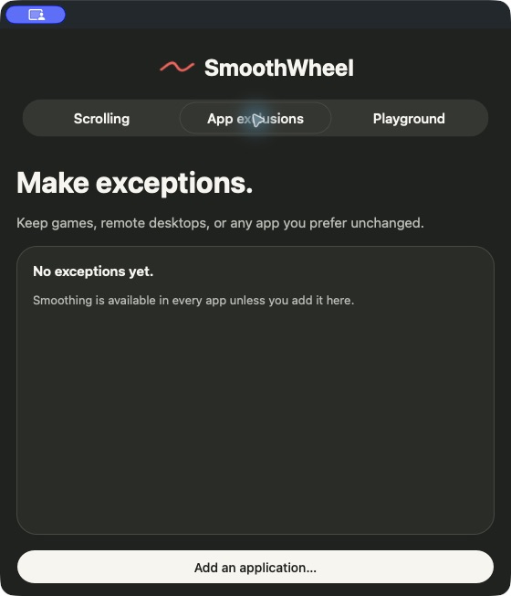

# SmoothWheel

**A familiar mouse. A smoother Mac.**

A native macOS menu-bar utility for comfortable scrolling with standard third-party mouse wheels. Swift and AppKit. MIT licensed.

**[Download for Apple Silicon](https://github.com/AntonMazur/SmoothWheel/releases/latest/download/SmoothWheel.zip)** · [Website](https://smoothwheel.vercel.app) · [Release notes](CHANGELOG.md)

macOS 13 or later · Free and open source · Accessibility permission required

The current download is **ad-hoc signed and not notarized**. macOS may require explicit approval before opening it. See [compatibility and known limitations](#compatibility-and-known-limitations).

<p>
  
  
</p>

## Get started

1. [Download SmoothWheel.zip](https://github.com/AntonMazur/SmoothWheel/releases/latest/download/SmoothWheel.zip), extract it, and move **SmoothWheel.app** to **Applications**.
2. Open the app and grant access in **System Settings → Privacy & Security → Accessibility**.
3. Turn on **Enable smoothing** and start with **Balanced**. Adjust speed and smoothing to your preference, or try the built-in **Playground**.

Smoothing starts disabled each launch. Hold **Option** while scrolling to temporarily bypass it. Add an app under **App exclusions** to keep its original scrolling. Close the settings window to keep SmoothWheel in the menu bar; quit from its menu.

## Features

- Smooth discrete vertical and horizontal wheel input across brands, with speed and smoothing controls.
- Precise, Balanced, and Relaxed presets. The 1× baseline travels three times the native wheel distance.
- Independent wheel direction; continuous trackpad events pass through.
- Per-app exclusions and a built-in scroll playground.
- Option bypass and Control/Command scrolling-shortcut passthrough.
- Local preferences, with no account, analytics, or network requests from the app.

Exclusions use the foreground app, including when hovering over background windows. Continuous events from other utilities pass through unchanged.

## Compatibility and known limitations

Version **0.3.11** is an Apple Silicon build, ad-hoc signed and not notarized. Physical Razer testing and native event/frame-clock regressions have been performed; broad application compatibility and the oldest supported macOS still need validation. Slight landing movement remains reported in Gmail. The reverted Chrome-specific trial is documented in the [changelog](CHANGELOG.md).

## Build and test

Requires macOS with Xcode 16+ and Swift Testing. The package targets macOS 13; the host architecture is built. macOS 14+ uses a display-linked clock, with a timer fallback on macOS 13.

```sh
./scripts/test.sh
./build.sh
./scripts/package-source.sh
```

The built app ZIP is `releases/SmoothWheel.zip`. Follow [Get started](#get-started) to install it. Rebuilding changes the ad-hoc signature and may require refreshing its existing Accessibility approval.

## Structure

- `Sources/ScrollCore`: motion mathematics and shared presets.
- `Sources/ScrollEvents`: testable Quartz event conversion.
- `Sources/ScrollTiming`: target-display frame clock.
- `Sources/SmoothWheel`: native app, controls, and engine lifecycle.
- `Tests`: motion, event-packet, native scrolling, and clock regressions.
- `design/tokens/soft-form.json`: native design-token source.
- `scripts`: build support, validation, and reproducible benchmarks.
- `docs`: release steps and performance investigations.

The website is a separate project. No website source, design boards, or website Git history is included here.

## Contributing

See [CONTRIBUTING.md](CONTRIBUTING.md) and [release preparation](docs/RELEASE.md). Use focused pull requests and meaningful behavior tests. There are no third-party runtime dependencies.

## License

[MIT](LICENSE). Independent project; no affiliation with Apple, Razer, or other mouse manufacturers.
