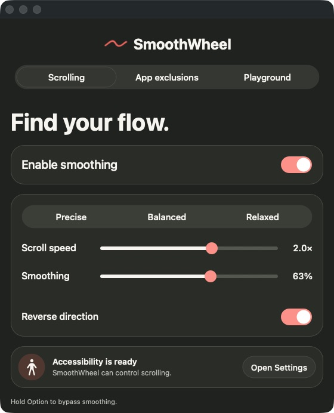

<p align="center">
  <a href="https://smoothwheel.vercel.app">
    
  </a>
</p>

<h1 align="center">SmoothWheel</h1>

<p align="center"><strong>A familiar mouse. A smoother Mac.</strong></p>

<p align="center">
  Turn stepped mouse-wheel scrolling into a smoother, more comfortable experience.<br />
  A native macOS menu-bar app, built with Swift and AppKit.
</p>

<p align="center">
  <a href="https://github.com/AntonMazur/SmoothWheel/releases/latest"></a>
  
  
  <a href="LICENSE"></a>
</p>

<p align="center">
  <a href="https://github.com/AntonMazur/SmoothWheel/releases/latest/download/SmoothWheel.zip"></a>
</p>

<p align="center">
  <a href="https://smoothwheel.vercel.app">Website</a> ·
  <a href="#get-started">Get started</a> ·
  <a href="CHANGELOG.md">Release notes</a> ·
  <a href="https://github.com/AntonMazur/SmoothWheel/issues">Report an issue</a>
</p>

<p align="center">Free and open source. No account. No analytics in the app.</p>

> The download is **ad-hoc signed and not notarized**. macOS may require explicit approval before opening it. Accessibility permission is required. [Compatibility details](#compatibility-and-known-limitations).

## Make scrolling feel right

Choose a preset, fine-tune the feel, and keep the original behavior in apps you exclude.

<table>
  <tr>
    <th align="center">Find your feel</th>
    <th align="center">Choose where it works</th>
  </tr>
  <tr>
    <td align="center"></td>
    <td align="center"></td>
  </tr>
  <tr>
    <td align="center">Precise, Balanced, or Relaxed.<br />Separate speed and smoothing controls.</td>
    <td align="center">Per-app exclusions.<br />Your preferences, your workflow.</td>
  </tr>
</table>

## Why SmoothWheel?

- **Smoother wheel scrolling.** Smooth discrete vertical and horizontal input from standard third-party mouse wheels.
- **Your preferred feel.** Three presets, separate speed and smoothing controls, and independent wheel direction.
- **Trackpad-friendly.** Continuous trackpad events pass through unchanged.
- **Control when you need it.** Per-app exclusions, Option to bypass, and Control/Command scrolling-shortcut passthrough.
- **Try it as you tune it.** A built-in scroll playground lets you test your settings.
- **Private and native.** Local preferences, no account or network requests from the app, and no third-party runtime dependencies.

## Get started

**Using Homebrew?** Install from the [developer-maintained tap](https://github.com/AntonMazur/homebrew-tap):

```sh
brew install --cask antonmazur/tap/smoothwheel
```

Then open SmoothWheel from Applications and follow steps 2–3 below. The current build requires Apple Silicon. See the [installation guide](docs/INSTALL.md) for first launch, updates, removal, and existing manual installations.

**Prefer a direct download?**

1. [Download SmoothWheel.zip](https://github.com/AntonMazur/SmoothWheel/releases/latest/download/SmoothWheel.zip), extract it, and move **SmoothWheel.app** to **Applications**.
2. Open the app and grant access in **System Settings → Privacy & Security → Accessibility**.
3. Turn on **Enable smoothing** and start with **Balanced**. Adjust speed and smoothing to your preference, or try the built-in **Playground**.

Smoothing starts disabled each launch. Hold **Option** while scrolling to temporarily bypass it. Add an app under **App exclusions** to keep its original scrolling. Close the settings window to keep SmoothWheel in the menu bar; quit from its menu.

### How it behaves

The 1× baseline travels three times the native wheel distance. Exclusions follow the event’s receiving process, including inactive windows and system popovers. Known destinations use a cached identity lookup; asynchronous Accessibility hit-testing is a fallback for events without recipient metadata. An unresolved wheel burst passes through natively until its next burst. Background document renderers are tracked too, so Notes attachments receive smoothing and direction settings. Continuous events from other utilities pass through unchanged.

The [0.3.17 release notes](CHANGELOG.md#0317--2026-11-19) explain the scrolling fixes and include measured callback timing, frame intervals and test coverage, with their limits.

## Help test your mouse

Using a Logitech, Razer, Microsoft, or another standard mouse? A five-minute test can help other Mac users choose with more confidence. Reports of smooth scrolling are just as useful as bug reports.

**[Share your mouse and app results](https://github.com/AntonMazur/SmoothWheel/issues/new?template=compatibility_report.yml)** · [Compatibility table and test guide](docs/COMPATIBILITY.md)

## Compatibility and known limitations

Version **0.3.17** is an Apple Silicon build, ad-hoc signed and not notarized. Physical Razer testing and native event/frame-clock regressions have been performed; broad application compatibility and the oldest supported macOS still need validation. Slight landing movement remains reported in Gmail. The reverted Chrome-specific trial is documented in the [changelog](CHANGELOG.md).

## Build and test

Requires macOS with Xcode 16+ and Swift Testing. The package targets macOS 13; the host architecture is built. macOS 14+ uses a display-linked clock, with a timer fallback on macOS 13.

```sh
./scripts/test.sh
./build.sh
./scripts/package-source.sh
```

See [testing and measurement](docs/TESTING.md) for coverage gates, snapshot review, and the optimized engine benchmark.

The built app ZIP is `releases/SmoothWheel.zip`. Follow [Get started](#get-started) to install it. Rebuilding changes the ad-hoc signature and may require refreshing its existing Accessibility approval.

## Structure

- `Sources/ScrollCore`: motion mathematics and shared presets.
- `Sources/ScrollEvents`: testable Quartz event conversion.
- `Sources/ScrollTiming`: target-display frame clock.
- `Sources/SmoothWheelAppCore`: native controls, settings, diagnostics, and testable engine coordinator.
- `Sources/SmoothWheel`: executable entry point.
- `Tests`: production-engine replays, UI snapshots, motion, native scrolling, resolver, and clock regressions.
- `design/tokens/soft-form.json`: native design-token source.
- `scripts`: build support, validation, and reproducible benchmarks.
- `docs`: release steps and performance investigations.

The website is a separate project. No website source, design boards, or website Git history is included here.

## Contributing

See [CONTRIBUTING.md](CONTRIBUTING.md) and [release preparation](docs/RELEASE.md). Use focused pull requests and meaningful behavior tests. There are no third-party runtime dependencies.

## License

[MIT](LICENSE). Independent project; no affiliation with Apple, Razer, or other mouse manufacturers.
