# SmoothWheel screenshots

[Back to SmoothWheel](../../README.md).

[Light appearance](#light-appearance) · [Dark appearance](#dark-appearance)

## Light appearance

| Scrolling settings | App exclusions | Playground |
| --- | --- | --- |
| 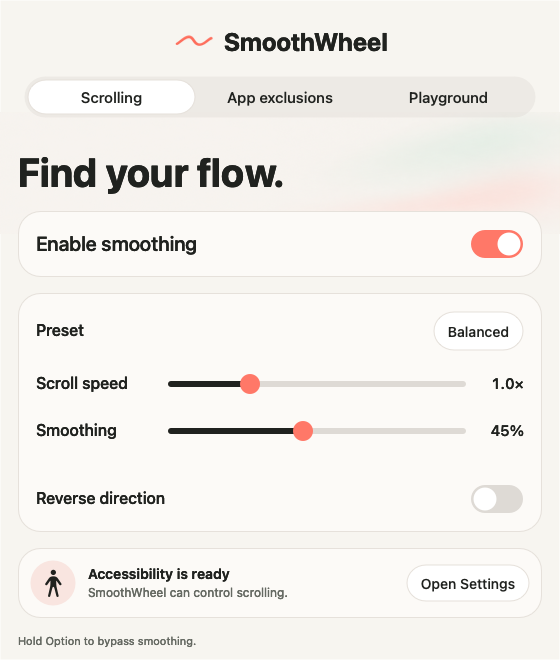 | 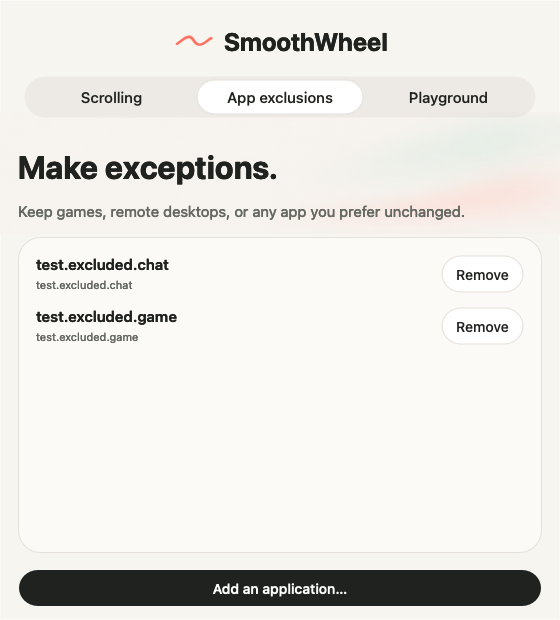 | 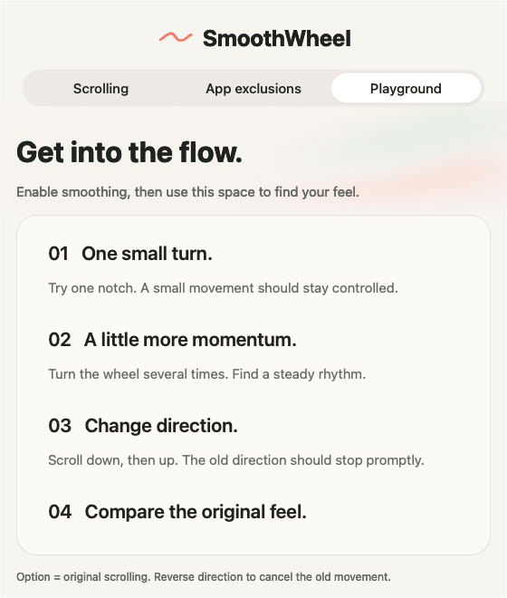 |

| Preset picker | Save preset | Manage presets |
| --- | --- | --- |
| 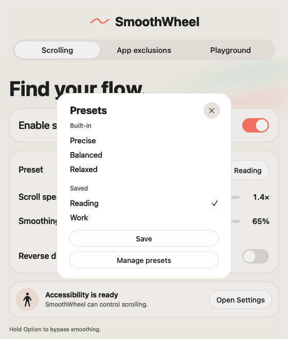 | 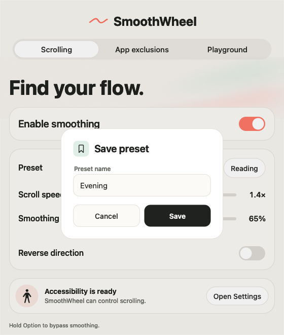 | 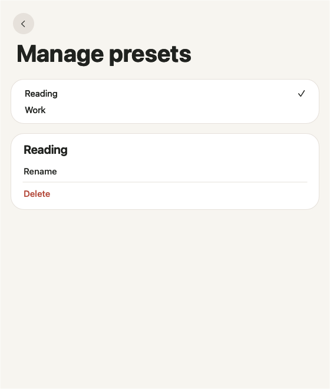 |

| Rename preset | Delete preset |
| --- | --- |
| 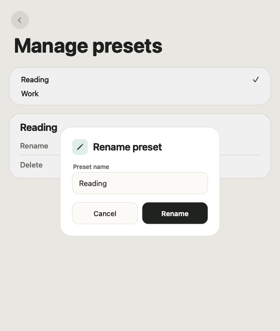 | 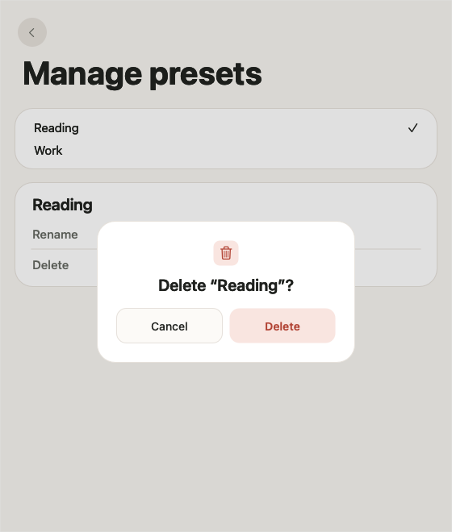 |

## Dark appearance

| Scrolling settings | App exclusions | Playground |
| --- | --- | --- |
| 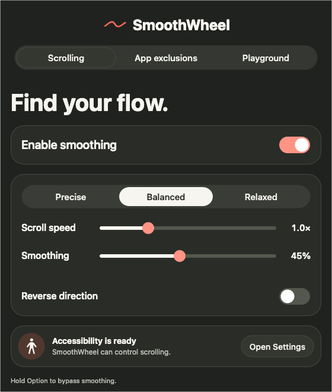 | 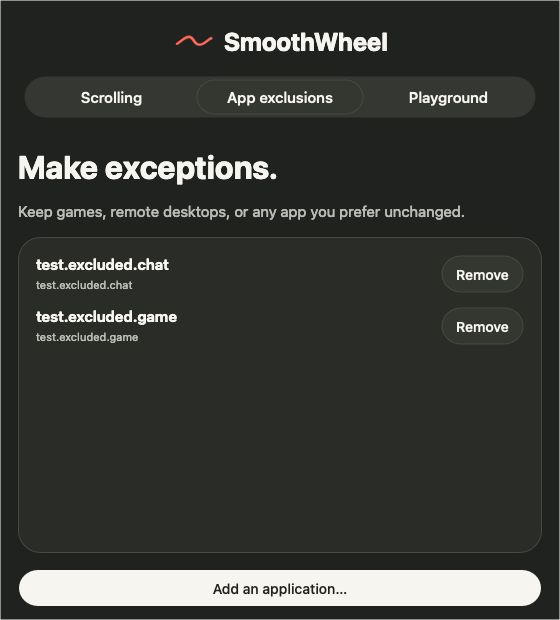 | 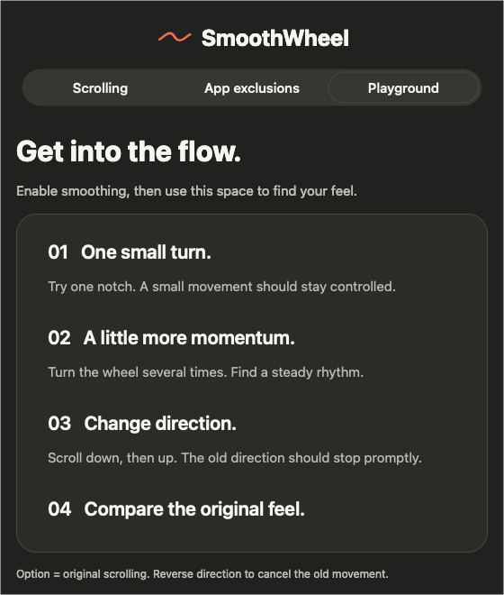 |

| Preset picker | Save preset | Manage presets |
| --- | --- | --- |
| 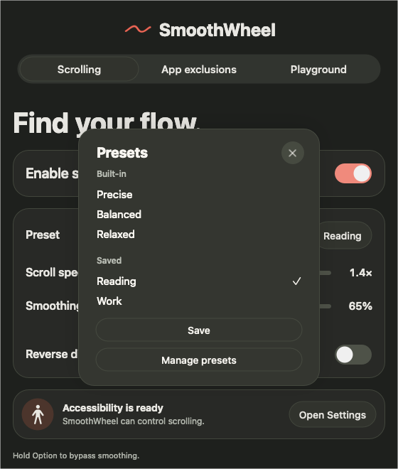 | 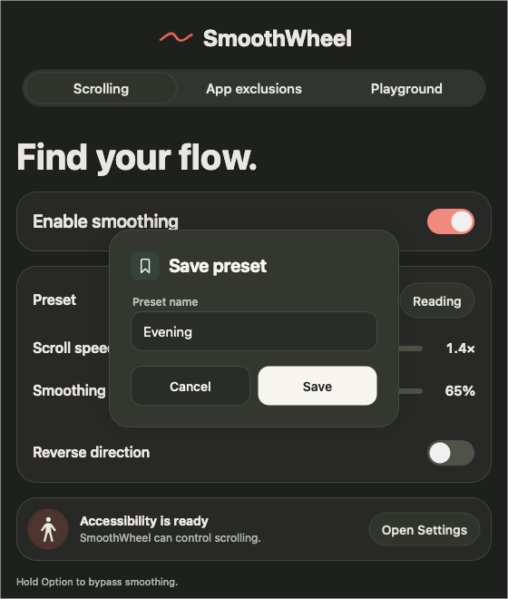 | 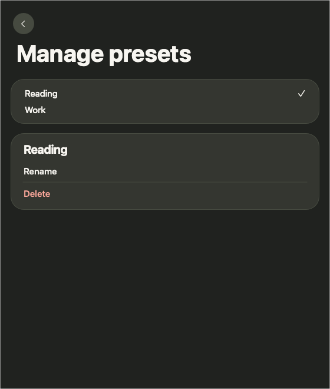 |

| Rename preset | Delete preset |
| --- | --- |
| 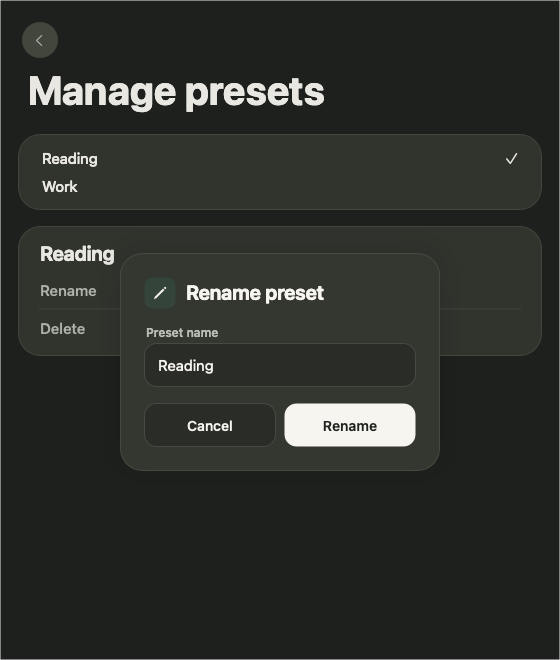 | 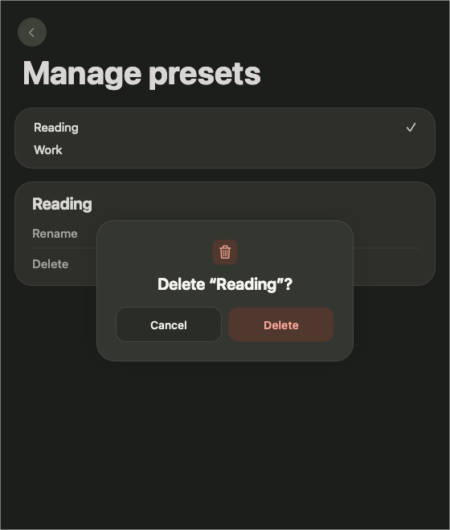 |
